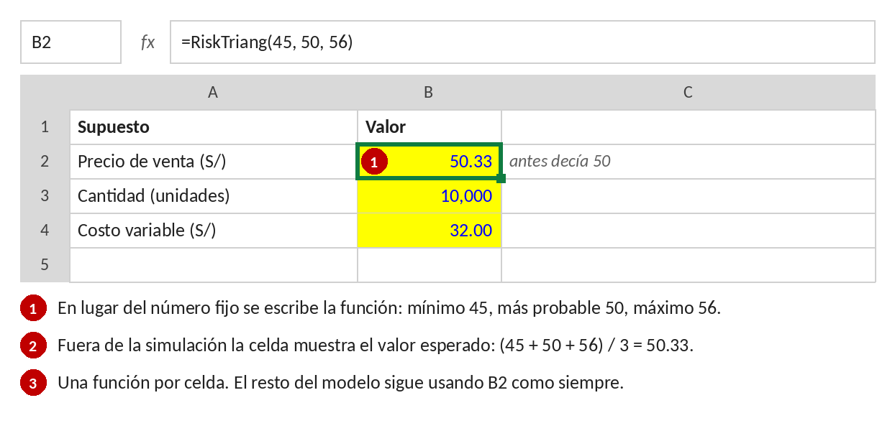
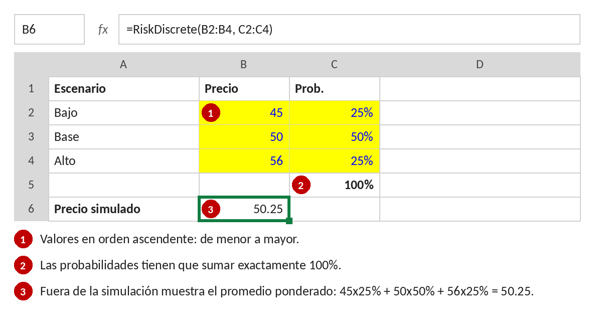
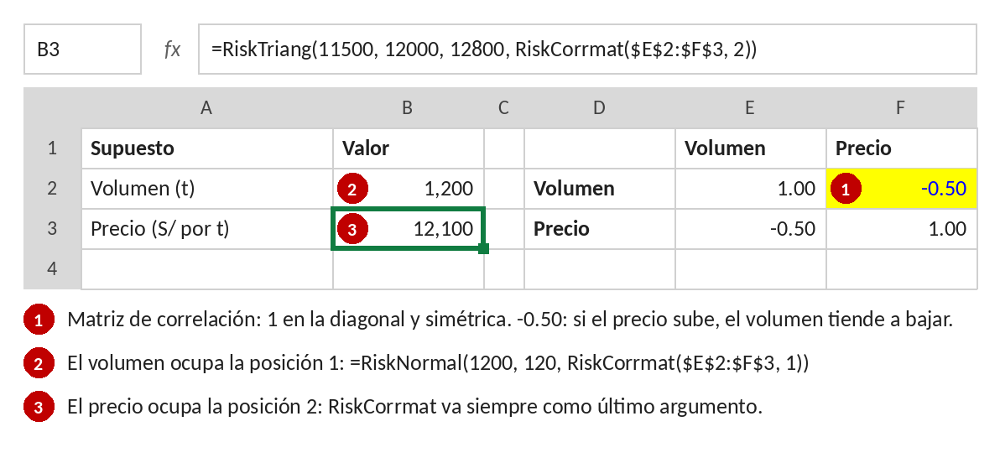
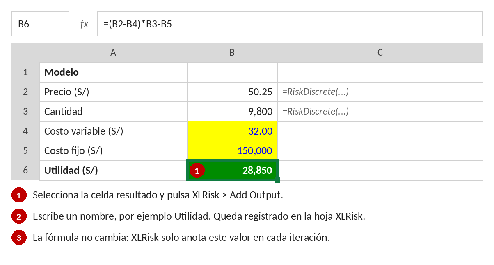
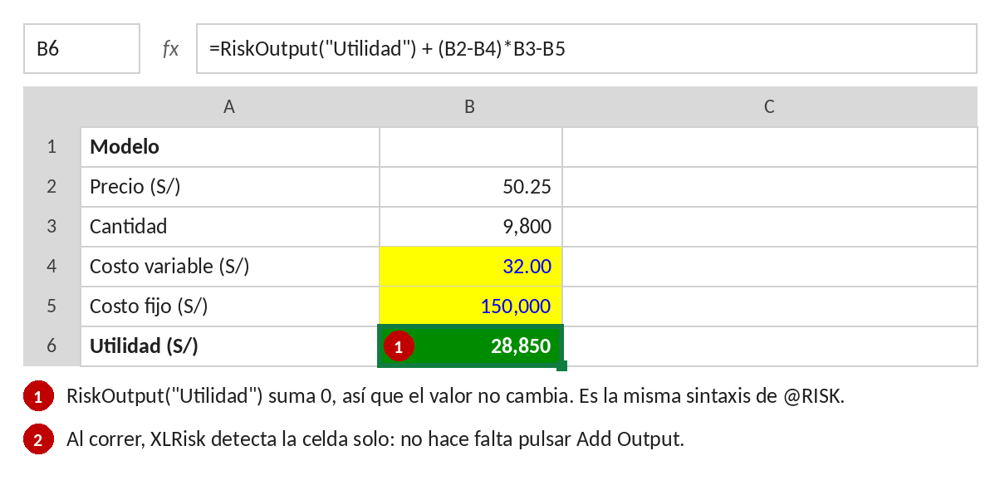
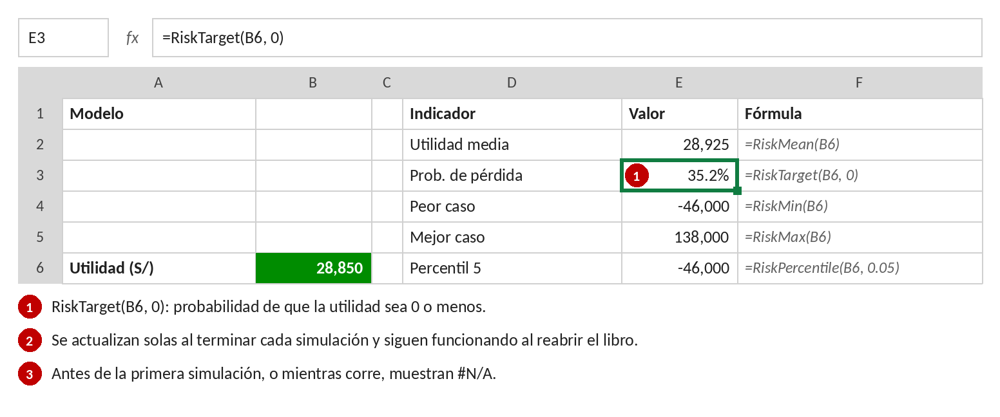
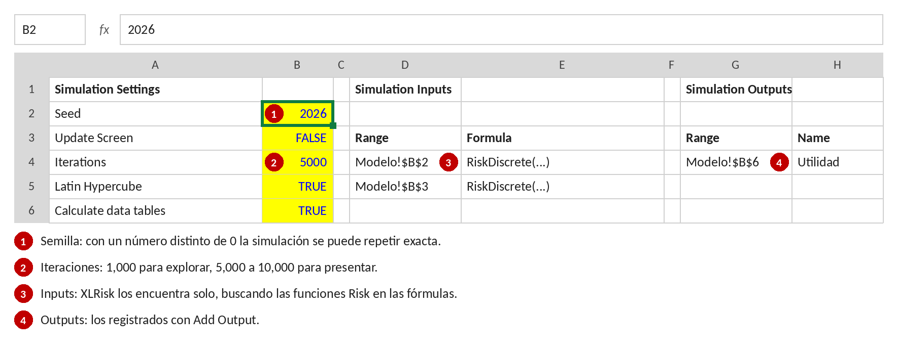
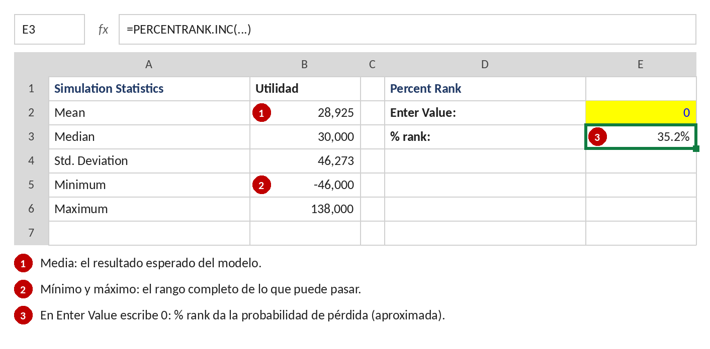

# XLRisk 1.2.0: manual en español

XLRisk es un complemento gratuito y de código abierto para hacer simulación Monte Carlo en Excel.

Convierte un modelo determinístico (un solo escenario) en uno probabilístico: los supuestos inciertos pasan a ser distribuciones, Excel recalcula el modelo miles de veces y el resultado deja de ser un número para convertirse en un rango con su probabilidad.

Ejemplo: en vez de "la utilidad será S/ 30,000", el modelo dice "la utilidad esperada es S/ 28,850 y hay 35% de probabilidad de pérdida".

Este manual corresponde a la versión 1.2.0 del fork https://github.com/Fjgl96/XLRisk, compatible con los libros hechos con el XLRisk original.

También está como libro de Excel, con el ejemplo listo para simular: [XLRisk_Manual_ES.xlsx](XLRisk_Manual_ES.xlsx).

## Instalación

| Paso | Qué hacer |
| --- | --- |
| Descargar | Baja XLRisk.xlam desde https://github.com/Fjgl96/XLRisk/raw/master/XLRisk.xlam. |
| Desbloquear | Clic derecho en el archivo > Propiedades > marca Desbloquear > Aceptar. Sin esto Excel lo abre en Vista protegida y no carga. |
| Copiar a la carpeta de complementos | Cópialo a %APPDATA%\Microsoft\AddIns. Es una ubicación de confianza de Excel, así que no vuelve a bloquearse. |
| Activar en Excel | Desarrollador > Complementos de Excel > Examinar > elige XLRisk.xlam > Aceptar. Si tenías una versión anterior, desmárcala primero. Aparece la pestaña XLRisk en la cinta. |
| Verificar | En cualquier celda escribe =XLRiskVersion(). Devuelve la versión instalada, por ejemplo 1.2.0. |

## Paso a paso

| Paso | Qué hacer |
| --- | --- |
| 1. Setup | Crea la hoja XLRisk en el libro, con la configuración y la lista de inputs y outputs. También abre el formulario de opciones. |
| 2. Definir inputs | Reemplaza cada supuesto incierto por una función de riesgo. Ejemplo: el precio 50 pasa a =RiskTriang(45, 50, 56). |
| 3. Definir outputs | Selecciona la celda resultado (utilidad, VAN, caja) y pulsa Add Output. Le pones un nombre. Desde la versión 1.2 también puedes escribirlo en la fórmula, como en @RISK: =RiskOutput("Utilidad") + ... Puedes tener varios outputs. |
| 4. Iteraciones y semilla | Elige las iteraciones en la cinta (1,000 a 10,000). Con una semilla distinta de 0 en la hoja XLRisk, la simulación se puede reproducir exacta. |
| 5. Run | Corre la simulación. Stop la detiene. Al terminar crea una hoja de resultados nueva. |

### Botones de la pestaña XLRisk

| Botón | Qué hace |
| --- | --- |
| Setup | Crea la hoja XLRisk y abre las opciones de simulación. |
| Show Samples | Si está activo, las funciones de riesgo muestran valores aleatorios y cambian con F9. Si está apagado, muestran su valor esperado (el caso base). |
| Iterations | Número de iteraciones de la simulación. |
| Add Output | Registra la celda o rango seleccionado como output. |
| Run / Stop | Corre o detiene la simulación. |
| Compare Runs | Superpone en una hoja nueva (Risk Compare) las curvas acumuladas de un output en todas las hojas Risk Results, con una tabla de media, desviación, P5, mediana, P95 y probabilidad de quedar bajo 0 de cada corrida. Desde la versión 1.2. |
| Swap Functions | Cambia cada función Risk del libro por su valor esperado, para enviar el modelo a quien no tiene XLRisk. Al pulsarlo otra vez, devuelve las funciones. Desde la versión 1.2. |
| Help / About | Ayuda en línea y versión. |

## Ejemplos ilustrados

### Convertir un supuesto en una distribución

### Escenarios con su probabilidad: RiskDiscrete

### Hacer que dos supuestos se muevan juntos: RiskCorrmat

### Marcar el resultado con Add Output

### Marcar el resultado desde la fórmula: RiskOutput (versión 1.2)

### Traer los resultados a las celdas (versión 1.2)

### La hoja XLRisk

### Leer la hoja de resultados

## Funciones

Todas las funciones de distribución aceptan `RiskCorrmat` como último argumento opcional. Fuera de la simulación devuelven el valor de la columna "Fuera de la simulación".

| Sintaxis | Parámetros | Fuera de la simulación | Cuándo usarla | Ejemplo |
| --- | --- | --- | --- | --- |
| `RiskTriang(min, moda, max)` | Mínimo, valor más probable y máximo. Exige min < moda < max estricto. | (min + moda + max) / 3 | Juicio experto en tres puntos: pesimista, más probable, optimista. | `=RiskTriang(45, 50, 56)` |
| `RiskTriGen(P10, moda, P90, [p_inf], [p_sup])` | Valor en el percentil bajo, valor más probable y valor en el percentil alto. Los percentiles son 10% y 90% si no se indican. Desde la versión 1.2. | Media de la triangular que cumple esos percentiles | Juicio experto cuando el experto prefiere decir P10 y P90 en lugar de mínimo y máximo absolutos. | `=RiskTriGen(80, 100, 130)` |
| `RiskPert(min, moda, max)` | Igual que RiskTriang. Exige min < moda < max estricto. | (min + 4 x moda + max) / 6 | Como la triangular, pero con menos peso en los extremos. Plazos y costos de proyectos. | `=RiskPert(80, 100, 150)` |
| `RiskNormal(media, desv)` | Media y desviación estándar de la variable. | media | Variables simétricas alrededor de un valor. Puede dar negativos. | `=RiskNormal(10000, 1500)` |
| `RiskLogNorm(mu, sigma)` | OJO: mu y sigma son la media y la desviación de LN(X), no de X. Es la RiskLognorm2 de @RISK. | EXP(mu + sigma^2 / 2) | Variables positivas con cola a la derecha: precios, tipo de cambio, ventas. Ver Buenas prácticas para convertir media y desviación. | `=RiskLogNorm(LN(3.75) - 0.5*LN(1+(0.1/3.75)^2), SQRT(LN(1+(0.1/3.75)^2)))` |
| `RiskUniform(min, max)` | Mínimo y máximo. Todos los valores igual de probables. | (min + max) / 2 | Solo conoces el rango, sin un valor más probable. | `=RiskUniform(0.08, 0.12)` |
| `RiskDiscrete(valores, probabilidades)` | Dos rangos del mismo tamaño. Valores en cualquier orden (desde la versión 1.2); probabilidades que suman 1. | SUMAPRODUCTO(valores, probabilidades) | Escenarios con su probabilidad: bajo, base, alto. | `=RiskDiscrete(A2:A4, B2:B4)` |
| `RiskDUniform(valores)` | Un rango de valores, todos con la misma probabilidad. | promedio de los valores | Elegir al azar entre opciones igual de probables. | `=RiskDUniform(A2:A6)` |
| `RiskBernoulli(p)` | Probabilidad de que ocurra el evento (entre 0 y 1). | p | Evento que ocurre (1) o no (0): perder un cliente, aprobar un crédito. | `=RiskBernoulli(0.15)` |
| `RiskBinomial(n, p)` | Número de ensayos y probabilidad de éxito de cada uno. | n x p | Cuántos de n eventos independientes ocurren: clientes en mora de una cartera. | `=RiskBinomial(200, 0.04)` |
| `RiskExpon(media)` | Media de la variable. | media | Tiempo entre eventos: llegadas, fallas. | `=RiskExpon(12)` |
| `RiskGamma(alfa, beta)` | alfa = forma, beta = escala. | alfa x beta | Montos positivos asimétricos: siniestros, tiempos de servicio. | `=RiskGamma(2, 500)` |
| `RiskErlang(k, lambda)` | k = forma (entero), lambda = escala. Es una Gamma con forma entera. | k x lambda | Tiempo hasta que ocurren k eventos. | `=RiskErlang(3, 10)` |
| `RiskWeibull(alfa, beta)` | alfa = forma, beta = escala. | beta x GAMMA(1 + 1/alfa) | Vida útil y tiempo hasta falla de activos. | `=RiskWeibull(1.5, 1000)` |
| `RiskBeta(alfa, beta, [A], [B])` | alfa y beta = forma; A y B = mínimo y máximo (por defecto 0 y 1). | A + alfa / (alfa + beta) x (B - A) | Proporciones y tasas acotadas: tasa de conversión, porcentaje de recupero. | `=RiskBeta(2, 8)` |
| `RiskCumul(min, max, valoresX, probAcum)` | Curva acumulada por tramos. valoresX crecientes y dentro de (min, max); probAcum crecientes. | media de la curva definida | Cuando el experto da percentiles: "10% de que sea menos de X". | `=RiskCumul(0, 100, B2:B4, C2:C4)` |
| `RiskPoisson(lambda)` | Promedio de eventos en el periodo. Desde la versión 1.2. | lambda | Cantidad de eventos en un periodo: reclamos, fallas, pedidos urgentes. | `=RiskPoisson(4)` |
| `RiskLognorm2(mu, sigma)` | Igual que RiskLogNorm: media y desviación de LN(X). Nombre de @RISK. Desde la versión 1.2. | EXP(mu + sigma^2 / 2) | Modelos traídos de @RISK que usan RiskLognorm2. | `=RiskLognorm2(1.321, 0.040)` |
| `RiskOutput([nombre])` | Nombre opcional del output. Devuelve 0. Desde la versión 1.2. | 0 (no cambia la fórmula) | Marcar un output desde su fórmula, como en @RISK, sin usar Add Output. | `=RiskOutput("Utilidad") + (B2-B4)*B3-B5` |
| `RiskMean(celda)` | Celda output o input. Desde la versión 1.2. | media de la última simulación (#N/A si no hay) | Traer el resultado esperado a un reporte o dashboard. | `=RiskMean(B6)` |
| `RiskStdDev(celda), RiskMin(celda), RiskMax(celda)` | Celda output o input. Desde la versión 1.2. | desviación, mínimo y máximo de la última simulación | Mostrar la dispersión y el rango completo. | `=RiskMin(B6)` |
| `RiskPercentile(celda, p)  (alias RiskPtoX)` | p entre 0 y 1. Desde la versión 1.2. | valor en el percentil p | P5, P50, P95 para presentar el rango con cierta confianza. | `=RiskPercentile(B6, 0.05)` |
| `RiskTarget(celda, valor)  (alias RiskXtoP)` | Valor objetivo. Desde la versión 1.2. | probabilidad de quedar en el valor o por debajo | Probabilidad de pérdida (valor 0) o de no llegar a la meta. | `=RiskTarget(B6, 0)` |
| `RiskCorrmat(matriz, posición)` | Se pone como ÚLTIMO argumento de otra función. matriz = rango de correlaciones; posición = fila de esa variable en la matriz. | no aplica | Hacer que dos o más supuestos se muevan juntos (precio y cantidad, ventas de dos productos). | `=RiskNormal(100, 15, RiskCorrmat($H$2:$I$3, 1))` |
| `RiskIsValidCorrmat(matriz)` | Rango de correlaciones. | VERDADERO o FALSO | Verificar que la matriz sea válida (simétrica, diagonal 1, semidefinida positiva). | `=RiskIsValidCorrmat(H2:I3)` |
| `RiskCorrectCorrmat(matriz)` | Rango de correlaciones. Se ingresa como fórmula matricial del mismo tamaño. | matriz corregida | Corregir una matriz que no es válida, con el menor cambio posible. | `=RiskCorrectCorrmat(H2:I3)` |
| `RiskSCorrel(rango1, rango2)` | Dos rangos del mismo tamaño. | correlación de Spearman | Medir la correlación de rangos entre dos series. | `=RiskSCorrel(A2:A101, B2:B101)` |
| `XLRiskVersion()` | Sin argumentos. | "1.2.0" | Confirmar qué versión del complemento está cargada. | `=XLRiskVersion()` |

## Configuración: la hoja XLRisk

| Ajuste | Valor inicial | Qué controla |
| --- | --- | --- |
| Seed | 0 | Semilla. Con 0 cada corrida usa números distintos. Con cualquier otro número la simulación se reproduce exacta. |
| Update Screen | FALSO | Actualizar la pantalla en cada iteración. Apagado es mucho más rápido. |
| Iterations | 1000 | Iteraciones. También se cambia desde la cinta. |
| Latin Hypercube | VERDADERO | Muestreo estratificado. Converge más rápido que el muestreo simple; conviene dejarlo activo. |
| Calculate data tables | VERDADERO | Recalcular las tablas de datos de Excel en cada iteración. |
| Macro before / after | (vacío) | Nombre de una macro a correr antes o después de cada iteración, o al terminar la simulación. |
| RecalcOtherWorkbooks (opcional, desde 1.2) | no existe | Desde la versión 1.2, durante la simulación los demás libros abiertos dejan de recalcularse, lo que acelera mucho la corrida. Una celda con nombre RecalcOtherWorkbooks = VERDADERO vuelve al comportamiento anterior. |
| LegacyRnd (opcional) | no existe | Si agregas una celda con nombre LegacyRnd = VERDADERO, se usa el generador Rnd() de VBA del XLRisk original, para reproducir resultados antiguos. |

## Cómo leer los resultados

| Sección | Qué muestra |
| --- | --- |
| `Risk Outputs` | Los valores de cada output en cada iteración, junto con los inputs que los generaron. |
| Simulation Statistics | Media, mediana, moda, desviación estándar, varianza, curtosis, asimetría, mínimo, máximo, rango y conteo de iteraciones con error. |
| `Risk Output Percentiles` | Tabla de percentiles de cada output (P5, P50, P95, etc.). |
| Calculate Percent Rank | Escribes un valor y te dice qué porcentaje de iteraciones quedó por debajo. Sirve para probabilidad de pérdida o de no llegar a la meta. |
| Correlations | Correlación de cada input con cada output. |
| Output Cumulative Distributions | Curva acumulada de cada output. |
| Output Distributions | Histograma de cada output. En Excel 2013 sale como gráfico de columnas. |
| `Risk Tornado Diagram` | Qué inputs mueven más cada output, ordenados por correlación. En la celda Select Output eliges el output. |
| Output Mean Tornado | Tornado en las unidades del output (soles, dólares): para cada input, cuánto cambia la media del output entre su decil más bajo y su decil más alto, y qué parte aproximada de la varianza explica. Es el gráfico que se lleva a comité. Desde la versión 1.2. |

## Ejemplo: precio x cantidad

Precio 45 / 50 / 56 con probabilidades 25% / 50% / 25%; cantidad 8,000 / 10,000 / 12,000 con 30% / 50% / 20%; costo variable S/ 32; costo fijo S/ 150,000. Utilidad esperada exacta S/ 28,850 y probabilidad de pérdida exacta 35%. El libro de Excel trae el modelo armado.

1. Asegúrate de que XLRisk esté cargado (pestaña XLRisk en la cinta).
2. XLRisk > Setup. Se crea la hoja XLRisk.
3. Selecciona la celda Utilidad (C16) y pulsa Add Output. Nombre: Utilidad.
4. Opcional: selecciona C17 (Pérdida) y pulsa Add Output. Su media es la probabilidad de pérdida.
5. Iteraciones: 5000. En la hoja XLRisk pon una semilla, por ejemplo 2026.
6. Run. Compara la media de la hoja de resultados con el Chequeo exacto (columna F).

## Buenas prácticas y errores comunes

| Tema | Qué hacer |
| --- | --- |
| `RiskLogNorm usa los parámetros del logaritmo` | Para una variable con media m y desviación s: sigma = RAIZ(LN(1 + (s/m)^2)) y mu = LN(m) - sigma^2/2. Luego =RiskLogNorm(mu, sigma). Si pones m y s directo, simula EXP(m), que suele ser un número absurdo. |
| Triangular y PERT exigen min < moda < max | Si el valor más probable es igual al mínimo o al máximo devuelven #VALOR!. Usa un mínimo apenas menor. |
| `RiskDiscrete: probabilidades que suman 1` | Los valores pueden ir en cualquier orden desde la versión 1.2; las probabilidades deben sumar exactamente 1. |
| Una función de riesgo por celda | `XLRisk detecta los inputs buscando las funciones en las fórmulas. Pon cada distribución en su propia celda y referencia esa celda en el resto del modelo.` |
| Cuántas iteraciones | 1,000 para explorar; 5,000 a 10,000 para presentar. Si la media cambia mucho entre dos corridas con semillas distintas, faltan iteraciones. |
| Fija la semilla para presentar | Con una semilla fija, quien revise el modelo obtiene exactamente los mismos números. |
| Matrices de correlación | Deben ser simétricas, con 1 en la diagonal y coherentes entre sí. Verifica con RiskIsValidCorrmat y corrige con RiskCorrectCorrmat. |
| Show Samples apagado para revisar el modelo | Así cada función muestra su valor esperado y el modelo se ve como el caso base. |

## Autopruebas

El complemento trae 58 pruebas automáticas que verifican el generador aleatorio, el muestreo, una simulación completa, las funciones nuevas, el tornado en soles, Compare Runs y Swap Functions contra resultados exactos.

Para correrlas: Alt+F8, escribe XLRisk.xlam!XLRiskSelfTests en Nombre de la macro y pulsa Ejecutar.

Tarda unos minutos. Abre un libro con cada prueba en PASS (verde) o FAIL (rojo). No guarda nada.

Conviene correrlas después de instalar una versión nueva.

## XLRisk frente a @RISK

| Capacidad | @RISK | XLRisk 1.2.0 |
| --- | --- | --- |
| Distribuciones | Más de 90 | 18 (ver hoja Funciones) |
| Latin Hypercube y correlaciones (Iman-Conover) | Sí | Sí |
| Semilla reproducible | Sí | Sí, desde la versión 1.2.0 |
| Histogramas, percentiles, tornado | Sí | Sí |
| Tornado en unidades del output (cambio en la media) | Sí | Sí, desde la versión 1.2 |
| Comparar corridas con curvas superpuestas | Sí | Sí, desde la versión 1.2 (Compare Runs) |
| Reemplazar funciones por valores para compartir (Swap) | Sí | Sí, desde la versión 1.2 |
| `RiskTrigen (triangular por percentiles)` | Sí | Sí, desde la versión 1.2 |
| `RiskOutput dentro de la fórmula` | Sí | Sí, desde la versión 1.2 |
| `RiskMean, RiskStdDev, RiskPercentile, RiskTarget en celda` | Sí | Sí, desde la versión 1.2 |
| `RiskLognorm2 (parámetros de LN(X))` | Sí | Sí, desde la versión 1.2 (y RiskLogNorm, igual) |
| `RiskLognorm(media, desv) de la variable` | Sí | No: RiskLogNorm usa los parámetros de LN(X) |
| Simulación sin recalcular otros libros abiertos | Sí | Sí, desde la versión 1.2 |
| Escenarios en una corrida (RiskSimtable) | Sí | No (próxima fase) |
| Ajuste de distribuciones a datos | Sí | No (Fase 3) |
| Precio | US$ 2,900 a 3,500 por licencia | Gratis, código abierto (licencia MIT) |

@RISK es marca comercial de Lumivero. XLRisk es un proyecto independiente.
